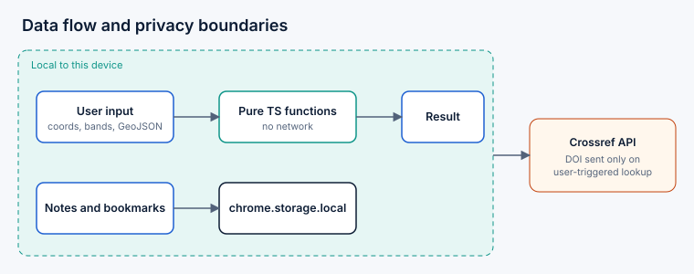

## GeoPilot: Your Geospatial Research Companion

> Navigate Data. Discover Insights.

GeoPilot is a Manifest V3 Chrome extension for GIS, remote-sensing and GeoAI work. A popup gives quick access; a side panel hosts the full workspace. Core tools run locally with no backend, no telemetry and no API keys.

**Status:** v1.0.0 source release. Not published on the Chrome Web Store. Verified in this build environment: type check, lint, 39 automated tests, production build. **Not verified:** loading and using the extension in a real Chrome browser (no Chrome was available). See `RELEASE_REPORT.md`.


## Features
- **Resource Hub** – 23 curated links to official geospatial resources, searchable, filterable, favorites.
- **Coordinate Converter** – decimal degrees, DMS, UTM ⇄ geographic (WGS 84, via proj4js) with validation and examples.
- **Spectral Index Lab** – NDVI, NDWI, MNDWI, NDBI, EVI, SAVI, BSI, NBR with formulas, limitations, references, sensor band mappings.
- **GeoJSON Toolkit** – JSON/structure validation, geometry counts, bbox, coordinate-range warnings, format/minify, copy/download (5 MB limit).
- **Research Companion** – save page / selection with source, notes, tags, collections, favorites, search, Crossref DOI lookup with provenance labels.
- **Citations** – BibTeX, RIS, CSL-JSON export; BibTeX/RIS/CSL-JSON import (Citation.js).
- **Code Library** – 11 original attributed snippets (Python, R, GEE JavaScript, PyQGIS).
- **Workflow Guides** – 12 educational guides (flood, drought, LULC, UHI, water change, climate risk, vulnerability, disaster risk, accessibility, location-allocation, VRP, digital twins).
- **Workspace** – dashboard from real local data, JSON backup/restore, clear-all with confirmation, light/dark themes.

More: [docs/FEATURES.md](docs/FEATURES.md), [docs/USER_GUIDE.md](docs/USER_GUIDE.md).

## Technology stack
TypeScript (strict), React 18, Vite, Tailwind CSS 3, Lucide, proj4js, Citation.js, Vitest + Testing Library, ESLint, Prettier.

## Architecture
Popup and side panel are separate React entries sharing components and a storage layer. A minimal service worker handles page capture (`chrome.scripting.executeScript` under `activeTab`) via sender-checked messages. Tools are lazy-loaded in the side panel. See [docs/ARCHITECTURE.md](docs/ARCHITECTURE.md).



## Installation
```bash
npm ci
npm run build
```
Open `chrome://extensions`, enable Developer mode, **Load unpacked**, choose `dist/`. Details: [docs/INSTALLATION.md](docs/INSTALLATION.md).

## Build and test
`npm run build` · `npm test` · `npm run lint` · `npm run typecheck` · `npm run format` · `npm run icons` · `npm run package`

## Permissions and privacy
`storage`, `activeTab`, `scripting`, `sidePanel`; no host permissions. The only network call is a user-triggered DOI lookup to `api.crossref.org`. See [PRIVACY.md](PRIVACY.md) and [docs/PERMISSIONS.md](docs/PERMISSIONS.md).

## Known limitations
- Not tested in a live Chrome browser by the author of this build.
- Page capture requires clicking the toolbar icon on the target page first (`activeTab`).
- GeoJSON checks are structural, not full RFC 7946/OGC conformance.
- UTM supports 80°S–84°N; no datum shifts other than WGS 84.
- Selection capture reads the page's current selection only (not inside cross-origin iframes).
- Screenshots are not included because no browser was available; figures are diagrams, not screenshots.
- DOI abstracts depend on what Crossref provides.

## Contributing
See [CONTRIBUTING.md](CONTRIBUTING.md). Roadmap: [docs/ROADMAP.md](docs/ROADMAP.md).

## Third-party acknowledgements
React, Vite, Tailwind CSS, Lucide, proj4js, Citation.js, Vitest, Testing Library, ESLint, Prettier, sharp. Each is under its own license; confirm in `node_modules/*/package.json` before redistribution. Data/links belong to their respective providers.

## Chrome Web Store checklist
- [ ] Load unpacked in Chrome and manually test every module
- [ ] Verify side-panel opening from the popup (see Known limitations in RELEASE_REPORT.md)
- [ ] Capture real screenshots (1280×800) and a 440×280 promo tile
- [ ] Host PRIVACY.md at a public URL for the listing
- [ ] Justify each permission in the dashboard (see docs/PERMISSIONS.md)
- [ ] Confirm dependency licenses; register a developer account; zip `dist/` contents
