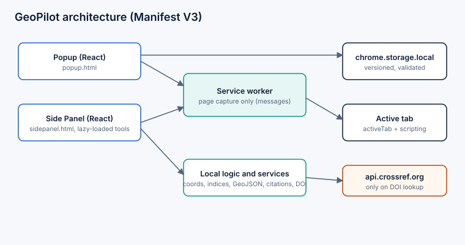

# Architecture

- `src/popup`, `src/sidepanel`: React entry points (separate HTML pages).
- `src/features/*`: one folder per module; pure logic (`coords.ts`, `indices.ts`, `geojson.ts`, `citations.ts`) is separated from React views and unit tested.
- `src/storage`: versioned schema (`SCHEMA_VERSION = 1`), sanitizing parser/migrator, `chrome.storage.local` wrapper (in-memory fallback outside the extension), React context.
- `src/background/index.ts`: service worker; handles `GP_CAPTURE_PAGE` after checking `sender.id`; injects a self-contained function via `chrome.scripting.executeScript`.
- `src/services`: Crossref client, messaging helpers.
- `src/data`: static resources, snippets, workflows, tools.
- Build: Vite multi-entry (popup, sidepanel, background); `scripts/postbuild.mjs` copies manifest/icons and checks referenced files exist.
- No content scripts are declared; page access is on demand via `activeTab`.
